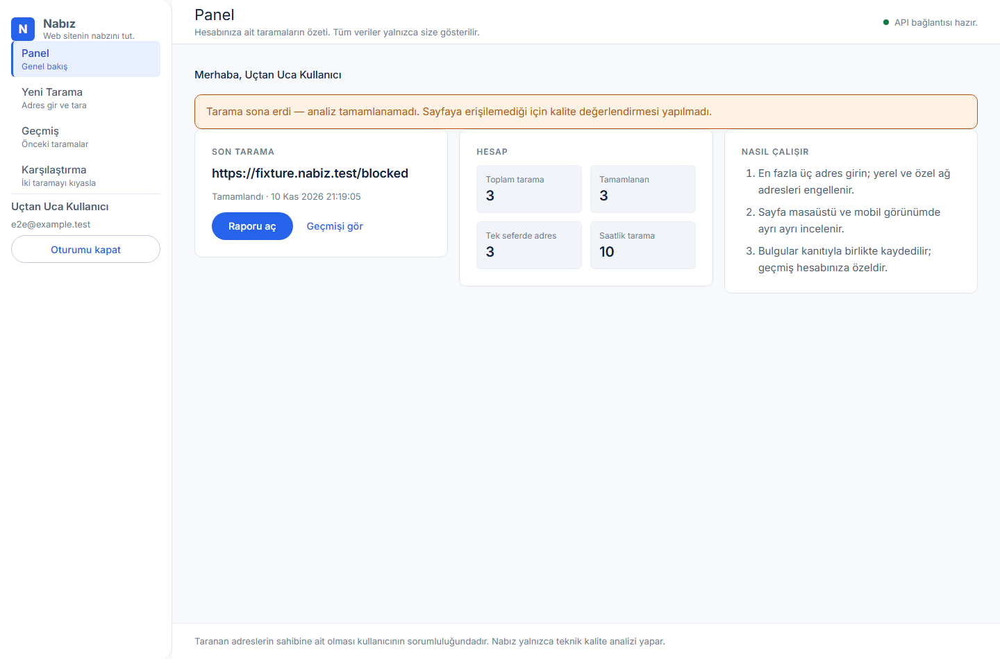
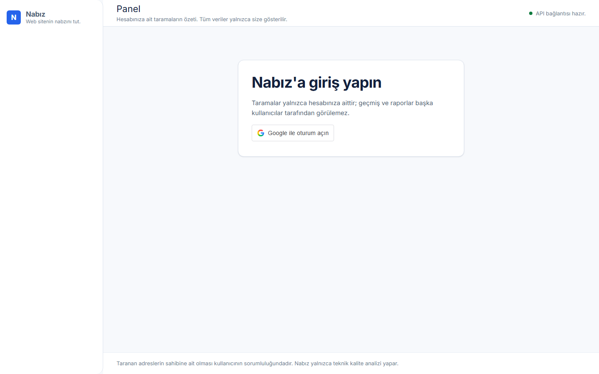
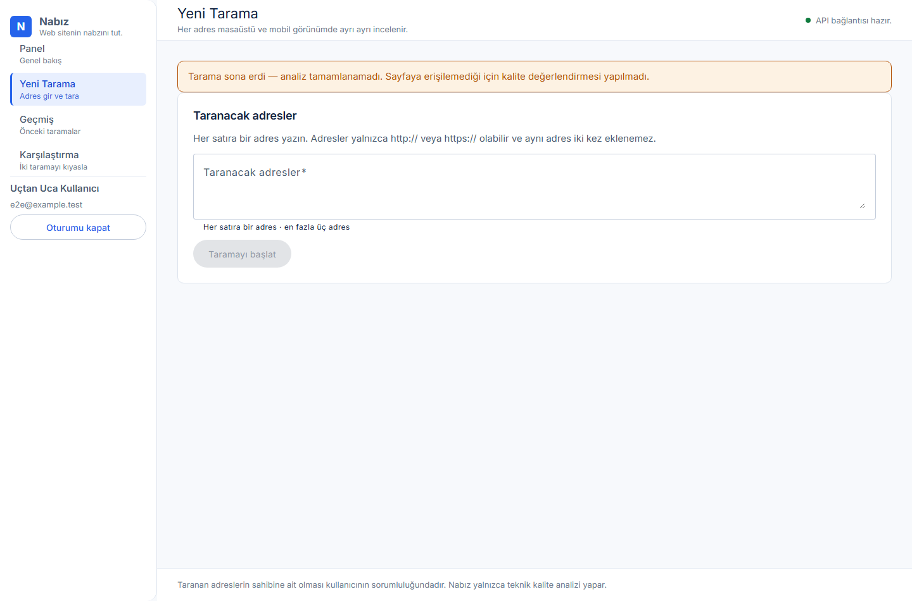
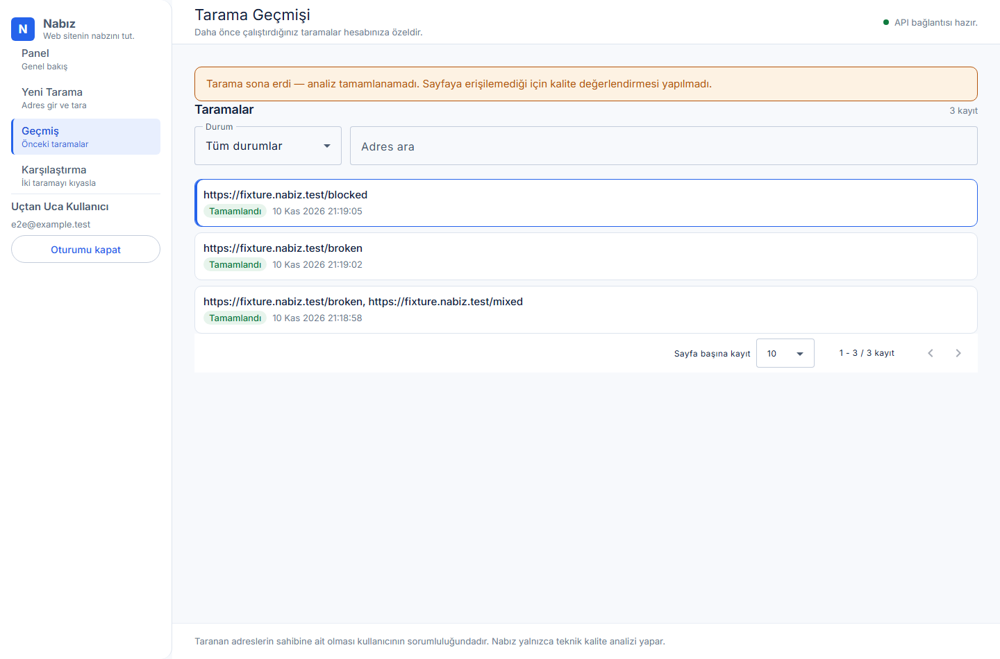
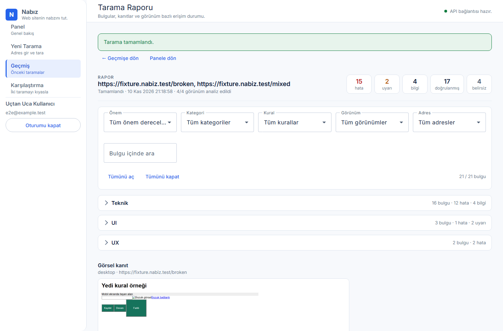
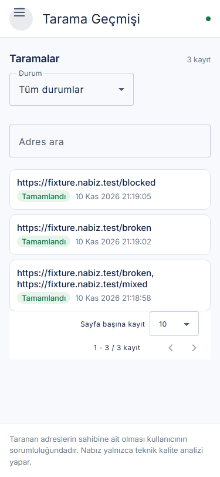

# Nabız

**Web sitenin nabzını tut.**

Nabız, bir web adresini teknik kalite, UI tutarlılığı ve erişilebilirlik açısından
inceleyen, bulguları kanıtlarıyla raporlayan ve iki taramayı karşılaştıran bir
web analiz platformudur.



## Amaç ve hedef kitle

- **Amaç:** Bir web sitesinin teknik kalite durumunu elle tarama yapmadan ve
  kanıtlarıyla birlikte görmek.
- **Hedef kitle:** Geliştiriciler, QA uzmanları ve ajans ekipleri. Kişisel
  projeler, küçük ekipler ve portföy çalışmaları için tasarlanmıştır.
- **Kapsam dışı:** Hesaplanmayan kalite puanları, e-posta/şifre hesapları,
  ücretlendirme, abonelik ve bildirimler.

## Özellikler

- **Google ile giriş.** Google Identity Services akışı; oturum çerezi HttpOnly,
  SameSite=lax ve üretimde Secure; yazma isteklerinde CSRF koruması.
- **Hesap izolasyonu.** Tarama geçmişi ve raporlar yalnızca oturumu açan
  kullanıcıya görünür; başka kullanıcının işi 404 döner.
- **Güvenli tarama.** Yalnızca açık `http`/`https` hedefleri; özel IP, loopback,
  `localhost` ve `*.local` reddi; DNS sonucu doğrulaması ve IP'ye sabitleme;
  kuyruk, kota ve zaman aşımı limitleri.
- **Beş bağımsız analiz motoru.** Teknik kalite, UI/UX ve responsive,
  erişilebilirlik ve kontrast, SEO ile PageSpeed Insights birbirinden bağımsız
  çalışır; biri başarısız olduğunda diğerlerinin sonuçları korunur.
- **Ölçülebilir kontroller.** Her kural `geçti`, `sorun bulundu`,
  `doğrulanamadı` veya `çalıştırılmadı` sonucu üretir; "bulgu yok" ile "kural
  çalışmadı" ayrımı rapordan görülür.
- **axe-core ile erişilebilirlik.** WCAG 2.2 AA kapsamındaki otomatik
  denetlenebilir kurallar ve hesaplanmış renk kontrastı (oran, metin ve arka plan
  renkleriyle birlikte).
- **SEO denetimi.** Başlık, meta açıklama, başlık hiyerarşisi, canonical, robots,
  `lang`, viewport, Open Graph, Twitter Card, görsel alt metinleri, iç bağlantılar,
  yönlendirmeler ve JSON-LD geçerliliği ayrı ayrı kontrol edilir.
- **Masaüstü ve mobil.** Her adres iki viewport'ta ayrı incelenir; ek olarak birkaç
  kırılma noktası genişlikte düzen bozulmaları ölçülür.
- **Kanıtlı rapor.** Her bulgu; kural kodu, önem derecesi, güven düzeyi, DOM
  seçicisi, kanıt metni, çözüm önerisi ve ekran görüntüsüyle raporlanır.
- **Görsel kanıt.** Her erişilebilir sayfanın masaüstü ve mobil ekran
  görüntüsü dosya deposunda saklanır, yalnızca sahibine servis edilir ve raporda
  büyütülebilir.
- **Geçmiş ve karşılaştırma.** Aynı adresin iki taraması karşılaştırılır; yeni,
  devam eden, çözülen ve doğrulanamayan bulgular ayrıştırılır.
- **Erişim durumları.** 401/403/429, bot koruması veya CAPTCHA sayfası kalite
  kusuru sayılmaz; "Eksik tarama" olarak açıklanır.

## Teknolojiler

- **Frontend:** Angular 20 (standalone, zoneless), Angular Material 3 (M3 teması),
  Angular CDK, TypeScript strict, SCSS, HttpClient.
- **Backend:** Node.js 22/24, Express 5, TypeScript strict, Helmet, dotenv.
- **Veri:** Prisma 6 + SQLite (User, Session, OAuthAttempt, ScanJob, ScanArtifact).
- **Tarama:** Playwright (Chromium), axe-core ile erişilebilirlik denetimi.
- **Test:** Vitest, Supertest, gerçek Chromium ile E2E.
- **Kod kalitesi:** ESLint, Prettier, npm workspaces.

## Mimari ve klasör yapısı

```text
apps/api/
  prisma/schema.prisma      AppMetadata, User, Session, OAuthAttempt, ScanJob, ScanArtifact
  prisma/migrations/        Sürüm kontrollü migration'lar
  src/config/               Ortam değişkeni doğrulama
  src/middleware/           Tutarlı hata yanıtları
  src/modules/auth/         Oturum, CSRF, Google Identity Services
  src/modules/health/       /api/health ve /health
  src/modules/scanning/     Kuyruk, tarama motoru, kurallar, erişim sınıflandırma,
                            görsel deposu, motor durumları
  src/app.ts                HTTP uygulaması
  src/server.ts             Sunucu ve kontrollü kapanış
  tests/                    API, tarama ve erişim testleri + fixture sunucusu
apps/web/
  src/app/core/api/         API servisi ve ortak sözleşmeler
  src/app/core/auth/        Oturum durumu ve Google giriş bileşeni
  src/app/core/scans/       Panel, tarama, geçmiş, karşılaştırma, rapor görünümleri
  src/styles/               Tasarım token'ları ve tipografi
  src/environments/         Development ve production build ayarları
  tests/                    Servis ve rapor mantığı testleri
packages/contracts/
  api.d.ts                  Frontend/backend ortak TypeScript sözleşmeleri
docs/
  DESIGN-SYSTEM.md          Tasarım sistemi
  OPERATIONS.md             CI, migration, izolasyon ve yayın rehberi
  EXAMPLE-REPORT.md         Örnek rapor (fixture çıktısı)
  ROADMAP.md                v1.1 planı ve bilinen sınırlamalar
  images/                   Arayüz görselleri
scripts/
  install-browser.mjs       Chromium kurulumu
  e2e-web.mts               Uçtan uca test betiği
```

## Kurulum

Node.js 22.12+ (22.x) veya 24.x ve npm 10+ kullanın. `.nvmrc` varsayılan olarak
22 seçer. Komutları depo kökünde çalıştırın.

```powershell
npm install
Copy-Item apps/api/.env.example apps/api/.env
npm run prisma:validate
npm run prisma:generate
npm run db:deploy
npm run browser:install
npm run dev
```

- Frontend: **http://localhost:4300** (`APP_ORIGIN` içindeki adresle birebir aynı
  olmalıdır)
- API: http://127.0.0.1:3100/api/health

Tarama motoru gerçek Chromium kullandığı için `npm run browser:install` bir kez
çalıştırılmalıdır; tarayıcı `.cache/ms-playwright` altına kurulur.

Migration komutu temiz bir SQLite dosyası oluşturur. Önceden `db:push` ile
oluşturulmuş veritabanınız varsa silmeyin: tablo yapısının başlangıç migration
ile eşleştiğini doğruladıktan sonra `apps/api` içinde
`npx prisma migrate resolve --applied 20261108000000_init` ile başlangıç kaydını
işaretleyin. Yeni şema değişikliklerinde
`npm run db:migrate -w @nabiz/api -- --name degisiklik_adi` kullanın.

## Ortam değişkenleri

| Değişken                  | Zorunlu | Açıklama                                                              |
| ------------------------- | ------- | --------------------------------------------------------------------- |
| `DATABASE_URL`            | evet    | SQLite dosyası (`file:./nabiz.db`), şema klasörüne göreli             |
| `PORT`                    | hayır   | API portu (varsayılan 3100)                                           |
| `HOST`                    | hayır   | Bind adresi (varsayılan 127.0.0.1)                                    |
| `NODE_ENV`                | hayır   | `development`, `test` veya `production`                               |
| `APP_ORIGIN`              | evet    | Frontend origin'i; aynı origin'den gelmeyen istekler 403 alır         |
| `GOOGLE_CLIENT_ID`        | hayır   | Google Web istemci kimliği; boşsa giriş ekranı "yapılandırılmadı" der |
| `SCANNING_ENABLED`        | hayır   | `true` ise açık URL taraması açılır (varsayılan `false`)              |
| `PAGESPEED_ENABLED`       | hayır   | PageSpeed Insights sorguları açık/kapalı (varsayılan açık)            |
| `PAGESPEED_API_KEY`       | hayır   | Google API anahtarı; anahtarsız çağrı anonim kotaya tabidir           |
| `ARTIFACT_DIR`            | hayır   | Ekran görüntüsü deposu (varsayılan `apps/api/.data/artifacts`)        |
| `ARTIFACT_MAX_BYTES`      | hayır   | Tek görsel için en fazla bayt (varsayılan 2 MB)                       |
| `ARTIFACT_MAX_PER_SCAN`   | hayır   | Tarama başına en fazla görsel (varsayılan 24)                         |
| `ARTIFACT_RETENTION_DAYS` | hayır   | Görsellerin saklama süresi (varsayılan 30 gün)                        |

`.env` dosyası kaynakta ve derlenmiş çalıştırmada aynı konumdan okunur; işletim
sistemi değişkenleri önceliklidir. Gerçek `.env`, veritabanları ve üretilen
dosyalar Git tarafından dışlanır.

## Google OAuth kurulumu

Google Identity Services akışı **istemci sırrı kullanmaz**; yalnızca Web
istemci kimliği gerekir.

1. [Google Cloud Console](https://console.cloud.google.com/apis/credentials) →
   yeni bir **OAuth 2.0 Client ID** → uygulama türü **Web application**.
2. **Authorized JavaScript origins** listesine tam olarak
   `http://localhost:4300` yazın (port dâhil, sonunda `/` yok).
   `http://127.0.0.1:4300` **farklı bir origin** olarak sayılır; ikisini de
   kullanacaksanız ikisini de kaydedin.
3. İstemci kimliğini `apps/api/.env` içine yazın:

   ```ini
   GOOGLE_CLIENT_ID=xxxxx.apps.googleusercontent.com
   APP_ORIGIN=http://localhost:4300
   ```

4. `APP_ORIGIN` ile tarayıcıda kullandığınız adres birebir aynı olmalıdır.
   Farklı bir adres kullanırsanız Google düğmesi yüklenmez ve API istekleri
   403 döner.
5. API'yi yeniden başlatın. Kayıt değişikliklerinin Google'ın sunucularına
   yayılması birkaç dakika sürebilir; düğme hâlâ "origin is not allowed"
   uyarısı veriyorsa sayfayı zorla yenileyin ve birkaç dakika sonra tekrar
   deneyin.

## Analiz kuralları

Kurallar kategoriye göre gruplanır; her kural hem bulgu hem de kontrol kaydı
üretir.

| Kategori            | Kurallar                                                                                                                                                                                                                                                                                                |
| ------------------- | ------------------------------------------------------------------------------------------------------------------------------------------------------------------------------------------------------------------------------------------------------------------------------------------------------- |
| Teknik              | **T01** JavaScript hatası · **T02** başarısız kaynak · **T03** bozuk iç bağlantı · **T04** bozuk görsel                                                                                                                                                                                                 |
| UI/UX ve responsive | **U02** yatay taşma · **U04** buton stili · **U10** viewport dışı içerik · **U11** kırpılan içerik · **U12** dokunma hedefi · **U13** yakın etkileşim öğeleri · **U14** yazı boyutu · **U17** kırılma noktası bozulması                                                                                 |
| Erişilebilirlik     | **A01** axe-core kuralları · **A02** metin kontrastı · **A03** büyük metin kontrastı · **A04** form erişilebilirliği · **A05** ARIA hataları · **A06** görsel alt metinleri · **A07** bağlantı/düğme isimleri · **A08** klavye erişimi                                                                  |
| UX                  | **X01** form alanı etiketi · **U15** erişilebilir isim · **U16** odak göstergesi                                                                                                                                                                                                                        |
| SEO                 | **S01** title · **S02** meta açıklama · **S03** H1 sayısı · **S04** başlık hiyerarşisi · **S05** canonical · **S06** robots · **S07** `lang` · **S08** viewport · **S09** Open Graph · **S10** Twitter Card · **S11** görsel alt metni · **S12** iç bağlantılar · **S13** yönlendirme · **S14** JSON-LD |

Her kural bir **çözüm önerisi** ve **kanıt** ile raporlanır. Doğrulanamayan
durumlar (erişim engeli, ağ engeli, ölçülemeyen arka plan) "doğrulanamadı"
olarak işaretlenir; kesin hata olarak sunulmaz. SEO önerileri sıralama garantisi
değildir. Örnek bir çıktı: [docs/EXAMPLE-REPORT.md](docs/EXAMPLE-REPORT.md).

## API endpoint'leri

Tüm yanıtlar `{ "data": … }` veya `{ "error": { code, message, requestId } }`
biçimindedir.

| Yöntem | Yol                                      | Yetki              | Açıklama                                         |
| ------ | ---------------------------------------- | ------------------ | ------------------------------------------------ |
| GET    | `/api/health`, `/health`                 | —                  | Süreç sağlığı (veritabanı kontrolü değildir)     |
| GET    | `/api/auth/session`                      | —                  | Oturum durumu ve yapılandırma bilgisi            |
| POST   | `/api/auth/google/challenge`             | aynı origin        | Google girişi için state/nonce üretir            |
| POST   | `/api/auth/google`                       | aynı origin + CSRF | Google kimlik belirtecini doğrular, oturum açar  |
| GET    | `/api/auth/me`                           | oturum             | Oturumdaki kullanıcı                             |
| POST   | `/api/auth/logout`                       | oturum + CSRF      | Oturumu kapatır                                  |
| GET    | `/api/scans/capabilities`                | oturum             | Tarama açık mı, adres ve kota sınırları          |
| GET    | `/api/scans`                             | oturum             | Kullanıcının tarama geçmişi (en fazla 100 kayıt) |
| POST   | `/api/scans`                             | oturum + CSRF      | Tarama başlatır (1–3 adres)                      |
| GET    | `/api/scans/:id`                         | oturum             | Tarama detayı ve sonuçlar                        |
| POST   | `/api/scans/:id/cancel`                  | oturum + CSRF      | Taramayı iptal eder                              |
| GET    | `/api/scans/:id/artifacts`               | oturum             | Taramaya ait ekran görüntüsü kayıtları           |
| GET    | `/api/scans/artifacts/:artifactId`       | oturum             | Ekran görüntüsü (PNG; yalnızca sahibine)         |
| GET    | `/api/scans/compare/:before/:after?url=` | oturum             | İki taramayı karşılaştırır                       |

### Veri modelleri

- **User** — `id`, `googleSub` (benzersiz), `email`, `name`, `createdAt`
- **Session** — `tokenHash` (çerez değil, hash saklanır), `userId`, `expiresAt`
- **OAuthAttempt** — `stateHash`, `nonce`, `verifier`, `expiresAt`
- **ScanJob** — `id`, `userId`, `urls`, `status`
  (`queued|running|completed|failed|cancelled`), `progress`, `error`, `result`,
  `createdAt`, `updatedAt`
- **ScanArtifact** — `id`, `scanId`, `userId`, `kind` (`page|element`), `viewport`,
  `url`, `selector`, `fileName`, `bytes`, `createdAt`

Ortak sözleşmeler `packages/contracts/api.d.ts` içindedir.

## Tarama güvenliği ve kullanım sınırları

- Açık URL taraması **varsayılan olarak kapalıdır** (`SCANNING_ENABLED=false`).
  Açmak için ağ çıkış izolasyonunun doğrulanmış olması gerekir
  ([docs/OPERATIONS.md](docs/OPERATIONS.md)).
- Yalnızca `http`/`https`; özel IP, loopback, link-local, metadata adresleri ve
  `localhost`/`*.local` reddedilir. DNS sonucu her istekte doğrulanır ve
  bağlantı doğrulanmış IP'ye sabitlenir; yönlendirmenin her adımı yeniden
  denetlenir.
- Bot koruması veya CAPTCHA aşılmaz; erişilemeyen sayfa kalite kusuru olarak
  raporlanmaz.
- Taranan adreslerin sahibine ait olması kullanıcının sorumluluğundadır.
- Kota: kullanıcı başına 1 eşzamanlı tarama, saatlik 10 tarama, tek taramada
  en fazla 3 adres.

Ayrıntılı liste: [docs/OPERATIONS.md](docs/OPERATIONS.md).

## Erişim durumları

| Durum            | HTTP                 | Anlamı                                                         |
| ---------------- | -------------------- | -------------------------------------------------------------- |
| `ok`             | 2xx                  | Sayfa okundu, kalite kuralları çalıştı                         |
| `AUTH_REQUIRED`  | 401                  | Sayfa oturum istiyor; kusur sayılmadı                          |
| `ACCESS_DENIED`  | 403                  | Erişim kapalı; kusur sayılmadı                                 |
| `RATE_LIMITED`   | 429                  | İstek sınırı aşıldı; sayfa analiz edilmedi                     |
| `BOT_PROTECTION` | 401/403/429 veya 2xx | Bot koruması/CAPTCHA sayfası; korumayı aşma denemesi yapılmadı |
| `SERVER_ERROR`   | 5xx                  | Sayfa içeriği alınamadı; bu görünüm analiz edilemedi           |

Hiçbir görünüm analiz edilemediğinde bulgu sayacı gösterilmez; rapor
"değerlendirme yok" durumunu ve erişim açıklamasını gösterir.

## Arayüz ve tasarım sistemi

Frontend Angular Material (Material Design 3) ve Angular CDK üzerine kuruludur.
Renk, tipografi, boşluk, radius ve yükseklik değerleri tek kaynaktan yönetilir;
bileşenler kendi renk veya boşluk değerlerini yazmaz. Görsel kimlik, token
listesi ve uzun içerik kuralları [docs/DESIGN-SYSTEM.md](docs/DESIGN-SYSTEM.md)
dosyasında belgelidir.

Masaüstünde solda sabit bir menü bulunur ve dört görünümü açar: **Panel**,
**Yeni Tarama**, **Geçmiş** ve **Karşılaştırma**. 1024 px altında menü açılıp
kapanan bir panele dönüşür. **Rapor** ayrı bir görünümdür; sol üstteki
"Geçmişe dön" ve "Panele dön" yolları ile geçmişe ve panele kolayca dönülür.
Tarih, saat ve sayfalayıcı etiketleri Türkçe yerel ayarıyla gösterilir.

Uzun bulgu listeleri rapor bölümlerine ayrılır ve her bölüm varsayılan olarak
kapalıdır; "Tümünü aç / Tümünü kapat" kontrolleri bulunur. Kontrol kayıtları
ölçüm ve kanıtıyla birlikte gösterilir, geçmiş listesi sayfalanır ve
filtrelenir; rapor başlığı kaydırma sırasında ekranda kalır.

| Giriş                           | Yeni tarama                                 | Geçmiş                            | Rapor                           | Mobil                                  |
| ------------------------------- | ------------------------------------------- | --------------------------------- | ------------------------------- | -------------------------------------- |
|  |  |  |  |  |

> Görseller `npm run e2e` betiğinin gerçek Chromium çıktısıdır; veriler test
> fixture'larına aittir.

## Rapor içeriği

Her tarama raporu sekiz bölümden oluşur:

1. **Genel özet.** Motorların durumu, taranan sayfa sayısı ve bulgu dağılımı.
2. **Teknik analiz.** T01–T04 kontrolleri ve bulguları.
3. **UI/UX ve responsive.** U kurallarının ölçümleri, öğe kanıtlarıyla birlikte.
4. **Erişilebilirlik ve kontrast.** axe-core sonuçları ve hesaplanmış kontrast
   oranları.
5. **SEO.** S01–S14 kontrolleri; her kontrol için durum, kanıt ve öneri.
6. **PageSpeed Insights.** Mobil ve masaüstü için ayrı puanlar ve ölçümler.
7. **Masaüstü/mobil ekran görüntüleri.** Küçük önizlemeler ve büyütülebilir
   görüntüleme.
8. **Öncelikli düzeltme önerileri.** Bulgu sayısı ve önem derecesine göre
   sıralanmış, uygulanabilir öneriler.

Bölümler varsayılan olarak kapalıdır ve "Tümünü aç / Tümünü kapat"
kontrolleriyle açılır. Önem derecesi, kategori, kural, kontrol durumu, görünüm ve
adres filtreleri ile rapor içinde arama yapılabilir; rapor başlığı kaydırma
sırasında ekranda kalır, uzun listeler kademeli gösterilir.

Hiçbir görünüm analiz edilemediğinde bulgu sayacı gösterilmez; rapor
"değerlendirme yok" durumunu ve erişim açıklamasını gösterir.

### PageSpeed yapılandırması

```ini
PAGESPEED_ENABLED=true      # varsayılan: açık
PAGESPEED_API_KEY=...       # isteğe bağlı Google API anahtarı
```

API anahtarı olmadan çağrı yapılır ancak Google'ın anonim kotası çoğu zaman
doludur; bu durumda raporda Google'ın kota mesajı gösterilir. Gerçek puanlar
için [PageSpeed Insights API](https://developers.google.com/speed/docs/insights/v5/get-started)
sayfasından bir API anahtarı alıp `PAGESPEED_API_KEY` olarak tanımlayın.

**Anahtar kısıtlaması önemlidir.** Çağrı sunucu tarafından yapılır; istekte
`Referer` başlığı bulunmaz. Anahtar Google Cloud'da **"Web siteleri" (HTTP
yönlendirici)** kısıtlamasıyla sınırlandırılmışsa Google isteği
`Requests from referer <empty> are blocked` ile reddeder. Sunucu tarafı
kullanım için kısıtlamayı **"API'ler"** veya **"Hiçbiri"** yapın ve PageSpeed
Insights API'nin projede etkin olduğundan emin olun.

Hata sınıfları raporda ayrı gösterilir: `PAGESPEED_QUOTA` (kota doldu),
`PAGESPEED_PERMISSION` (yetkilendirme/yönlendirici kısıtlaması),
`PAGESPEED_INVALID_KEY` (geçersiz anahtar), `PAGESPEED_TIMEOUT`,
`PAGESPEED_NETWORK`, `PAGESPEED_UNAVAILABLE`. Google'ın ham hata mesajı her
zaman eklenir; puan uydurulmaz.

## Komutlar

```powershell
npm run build
npm run typecheck
npm run prisma:validate
npm run lint
npm run format:check
npm test
npm run e2e
npm run browser:install
Invoke-RestMethod http://127.0.0.1:3100/api/health
```

Health yanıtı: { "data": { "status": "ok", "service": "nabiz-api" } }.

### "İstek güvenlik kontrolünden geçemedi" hatası

Bu mesaj (`CSRF_REJECTED`), tarayıcının gönderdiği `Origin` başlığının API'deki
`APP_ORIGIN` ile eşleşmediğini gösterir. Geliştirme için kanonik adres
**http://localhost:4300**'dur:

- Tarayıcı **http://localhost:4300** adresini açmalıdır.
- `apps/api/.env` içindeki `APP_ORIGIN` **http://localhost:4300** olmalıdır.
- `http://127.0.0.1:4300` **farklı bir origin**'dir; bu adresi kullanırsanız
  API 403 döner. Dev proxy (`apps/web/proxy.conf.json`) `changeOrigin: false`
  kullandığı için tarayıcının origin'i olduğu gibi API'ye ulaşır.

Çerezi host'a bağlıdır: `127.0.0.1:4300` adresinde açılan bir oturum
`localhost:4300` adresinde gönderilmez. Yeni adreste giriş ekranı görürseniz
yeniden giriş yapın; yeni oturum güvenli biçimde oluşturulur.

Bu kural `apps/api/tests/origin.config.test.ts` ve
`apps/api/tests/origin.security.test.ts` testleriyle korunur.

`npm run format` dosyaları biçimlendirir. Testler health, 404, bozuk JSON,
gövde sınırı, eksik/geçersiz ortam değişkenleri, oturum ve yetkilendirme,
kullanıcı izolasyonu, tarama kuyruğu, iptal, karşılaştırma, erişim engeli
sınıflandırması, görsel deposu (boyut/adet/saklama sınırları), renk kontrastı
hesabı, SEO değerlendirmesi, gerçek Chromium taramaları ve frontend
servis/rapor mantığı testlerini kapsar. Analiz motorları kontrollü fixture
sayfalarıyla (sağlıklı sayfa, düşük kontrast, eksik SEO, mobil taşma, küçük
dokunma hedefleri, erişilebilirlik hataları) doğrulanır.

`npm run e2e` gerçek tarayıcıyla uçtan uca akışı doğrular: Angular arayüzü,
API, tarama motoru, SQLite ve sonuç ekranı. Test veritabanı geçici dosyada
açılır, oturum doğrudan test veritabanına yazılır; Google girişi kullanılmaz.
Kontroller: rapor bölümleri ve açma/kapatma, bulgu filtreleri, yapışkan rapor
başlığı, motor durumları, öncelikli öneriler, ekran görüntülerinin yüklenmesi ve
büyütülmesi, geçmiş, karşılaştırma, engellenen sayfanın "Eksik tarama" olarak
açıklanması, kullanıcı izolasyonu, 1440/768/375/320 px genişlikte yatay taşma
olmaması ve mobil menünün açılıp kapanması.

## Test ve katkı

Katkı rehberi, kod düzeni ve test yazım kuralları: [CONTRIBUTING.md](CONTRIBUTING.md).
CI iş akışı: [.github/workflows/ci.yml](.github/workflows/ci.yml). CI'daki hiçbir
adım gerçek bir Google hesabı veya ücretli servis gerektirmez.

## Production

```powershell
npm run prisma:generate
npm run db:deploy
npm run build
$env:NODE_ENV = 'production'
npm start -w @nabiz/api
```

API çıktısı apps/api/dist; frontend apps/web/dist/nabiz/browser. HTTPS reverse
proxy ile /api yolu backend'e yönlendirin. HOST varsayılan loopback; konteynerde
gerekiyorsa 0.0.0.0 kullanın. SQLite kalıcı, yazılabilir diskte tutulmalıdır.
Yayın kontrol listesi: [docs/OPERATIONS.md](docs/OPERATIONS.md).

## Bilinen sınırlamalar ve v1.1

Bilinen sınırlamalar ve planlanan v1.1 çalışmaları:
[docs/ROADMAP.md](docs/ROADMAP.md).

## Proje sahipliği ve katkı

Projenin sahibi, yöneticisi ve ürün kararlarının sorumlusu **Ceren Kurucu**'dur.
Geliştirme çalışmalarında OpenCode ve diğer yapay zekâ destekli kodlama
araçlarından yararlanılmıştır; bu araçlar proje sahibi, ürün yöneticisi veya
bağımsız geliştirici değildir. Katkı rehberi: [CONTRIBUTING.md](CONTRIBUTING.md).

## Lisans

Lisans tercihi proje sahibinin kararı bekliyor; bu depoda izinsiz bir lisans
dosyası eklenmemiştir.
