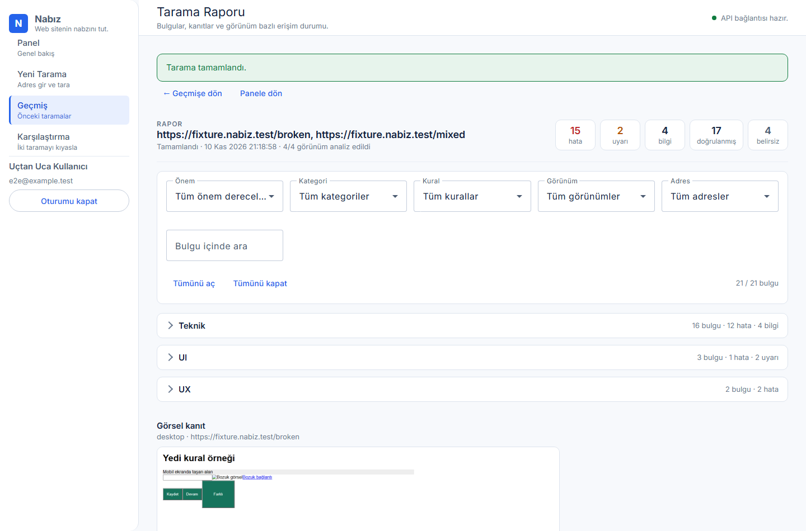

# Örnek Tarama Raporu

> **Bu rapor gerçek bir siteye ait değildir.** Aşağıdaki bulgular, projenin
> kendi test fixture'larına (`apps/api/tests/fixtures/`) karşı gerçek Chromium
> ile yapılan bir taramanın çıktısıdır. Fixture sayfaları bilerek hatalıdır ve
> kuralların nasıl çalıştığını gösterir. Gerçek bir siteye yapılmış hiçbir
> tarama bu belgede taklit edilmiştir.

Üretilen çıktı: `https://fixture.nabiz.test/broken` ve
`https://fixture.nabiz.test/mixed` adresleri, masaüstü (1440×900) ve mobil
(390×844) görünümleri.

| Görünüm | Adres   | Bulgular | Tamamlandı | Ekran görüntüsü |
| ------- | ------- | -------- | ---------- | --------------- |
| desktop | /broken | 6        | evet       | var             |
| mobile  | /broken | 7        | evet       | var             |
| desktop | /mixed  | 4        | evet       | var             |
| mobile  | /mixed  | 4        | evet       | var             |

Toplam: **21 bulgu** — 15 hata, 2 uyarı, 4 bilgi; 17 doğrulanmış, 4 belirsiz.



## 1. `T01` — JavaScript çalışma zamanı hatası (teknik, hata, doğrulanmış)

Sayfadaki betik çalışma zamanında hata fırlattığında kaydedilir.

- **Kanıt:** `Fixture: beklenen JavaScript hatası`
- **Öneri:** Hata kaynağını ve çağrı zincirini inceleyin.
- **Etkilenen görünümler:** desktop ve mobile

## 2. `T02` — Başarısız kaynak isteği (teknik, hata, doğrulanmış)

Sayfanın istediği bir kaynak 4xx/5xx döndürdüğünde raporlanır.

- **Kanıt:** `404 https://fixture.nabiz.test/missing.png`
- **Öneri:** HTTP yanıtını ve ağ yapılandırmasını kontrol edin.

Engellenen kaynaklar (401/403/429) **doğrulanmış hata sayılmaz**, "belirsiz"
olarak işaretlenir; koruma katmanı ile gerçek kırık dosya ayrılır:

- **Kanıt:** `403 https://fixture.nabiz.test/forbidden.png`
- **Durum:** belirsiz · bilgi

## 3. `T03` — İç bağlantı doğrulaması (teknik, hata, doğrulanmış)

Sayfadaki iç bağlantılar kontrollü biçimde yoklanır.

- **Kanıt:** `HTTP 404` (bağlantı: `https://fixture.nabiz.test/missing-link`)
- **Öneri:** Bağlantı hedefini ve yönlendirmeleri kontrol edin.

## 4. `T04` — Görsel yüklenemedi (teknik, hata, doğrulanmış)

Görsel yüklenmiş ama doğal boyutu olmadığı için görüntülenemiyorsa raporlanır.
DOM seçicisi bulgunun yerini gösterir.

- **Kanıt:** `https://fixture.nabiz.test/missing.png`
- **Seçici:** `html:nth-child(1) > body:nth-child(2) > img:nth-child(4)`
- **Öneri:** Görsel adresini ve dosyasını kontrol edin.

Bir görsel 403 ile engellendiyse "bozuk dosya" iddiası üretilmez; bulgu
belirsiz olarak işaretlenir.

## 5. `U02` — Mobil yatay taşma (UI, hata, doğrulanmış)

Mobil genişlikte sayfayı taşıran öğe tespit edilir; yalnızca mobil görünümde
raporlanır.

- **Kanıt:** `Viewport: 390px; sol: 20px; sağ: 920px.`
- **Seçici:** `html:nth-child(1) > body:nth-child(2) > div:nth-child(2)`
- **Öneri:** Sabit genişlikleri ve taşan elemanı inceleyin.

## 6. `U04` — Benzer butonlarda stil farkı (UI, uyarı, doğrulanmış)

Aynı sınıfı kullanan ve aynı DOM yapısına sahip butonların hesaplanmış CSS
değerleri karşılaştırılır. Çoğunluktan sapan buton "uyarı" olarak raporlanır;
kasıtlı bir varyant olabilir.

- **Kanıt:** `Grup çoğunluğu: […,"12px",…]; bu buton: […,"40px",…]. Kasıtlı varyant olabilir.`
- **Seçici:** `html:nth-child(1) > body:nth-child(2) > div:nth-child(6) > button:nth-child(3)`
- **Öneri:** Farkın kasıtlı bir varyant olup olmadığını inceleyin.

## 7. `X01` — Form alanının erişilebilir etiketi eksik (UX, hata, doğrulanmış)

`input`, `select` ve `textarea` alanlarında `label`, `aria-label` veya geçerli
`aria-labelledby` ilişkisi aranır. Gizli alanlar ve gizli (`type=hidden`)
alanlar kural dışıdır.

- **Kanıt:** `Alan için boş olmayan erişilebilir ad bulunamadı.`
- **Seçici:** `html:nth-child(1) > body:nth-child(2) > input:nth-child(3)`
- **Öneri:** Alanı label, aria-label veya geçerli aria-labelledby ile adlandırın.

## Karşılaştırma örneği

Aynı adresin iki taraması karşılaştırıldığında bulgular üç kovaya ayrılır:

| Kova           | Anlamı                                                                                   |
| -------------- | ---------------------------------------------------------------------------------------- |
| Yeni           | İkinci taramada ilk kez görülen bulgular                                                 |
| Devam eden     | Her iki taramada da bulunan bulgular                                                     |
| Çözülen        | İlk taramada vardı, ikincide yok ve ikinci tarama eksiksiz tamamlandı                    |
| Doğrulanamayan | İlk taramada vardı, ikincide yok ama ikinci tarama eksik olduğu için "giderildi" denemez |

Kısmi (erişim engelli) taramalarda düzelme iddiası üretilmez; bulgular
"doğrulanamayan" kovasında tutulur.

## Bu örneği yeniden üretmek

```bash
npm run browser:install
npm test          # fixture taramaları dahil tüm testler
npm run e2e       # gerçek Chromium ile uçtan uca akış
```
